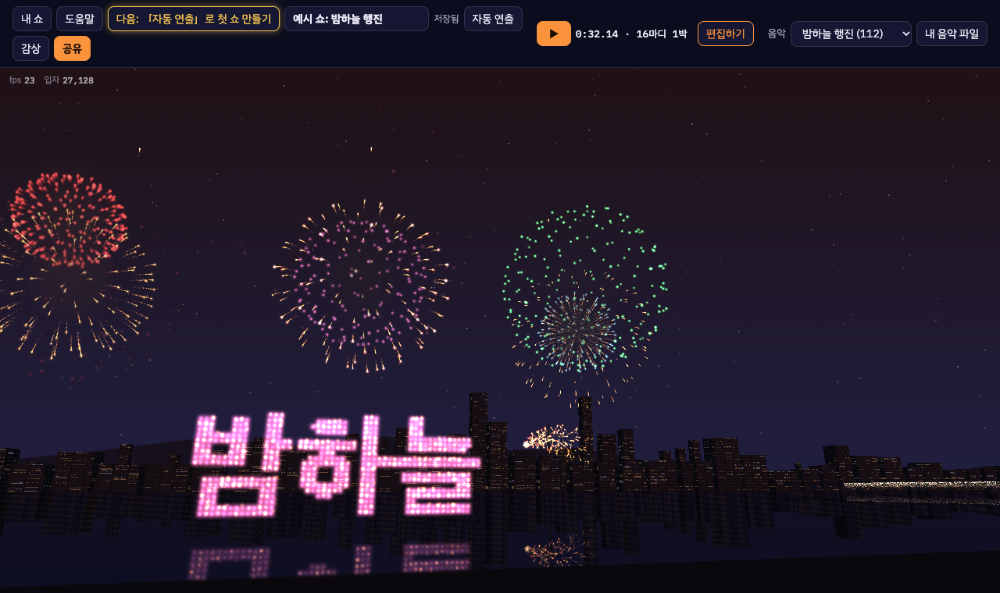
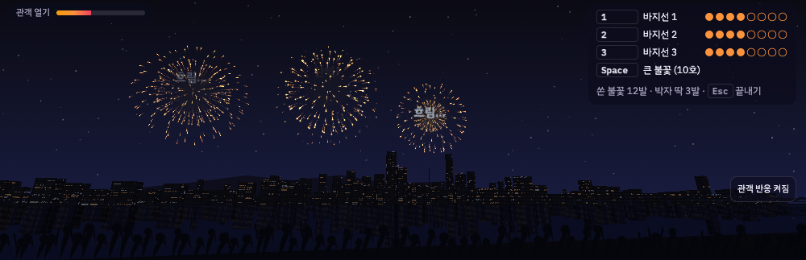
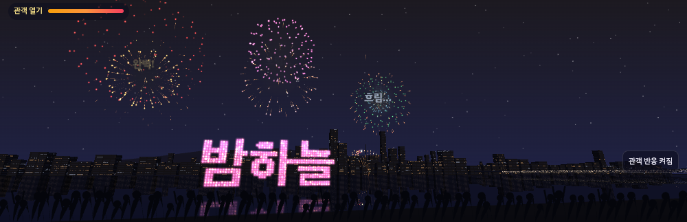
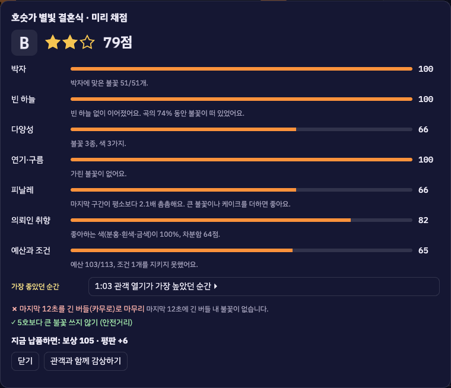
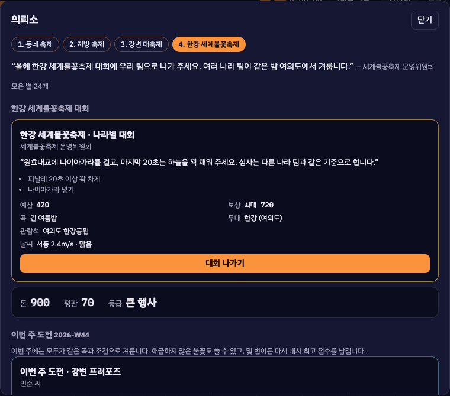
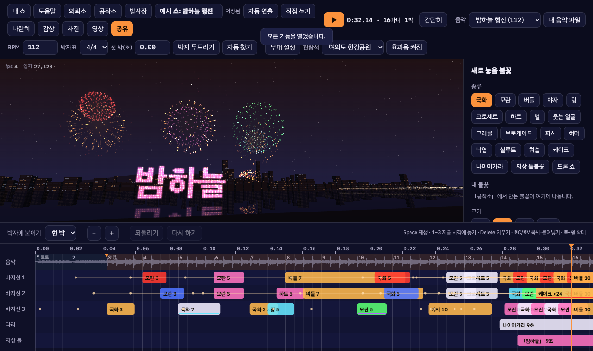
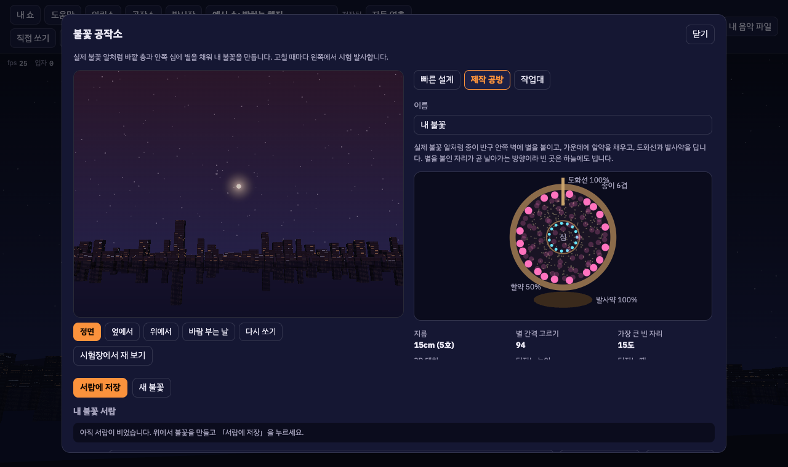
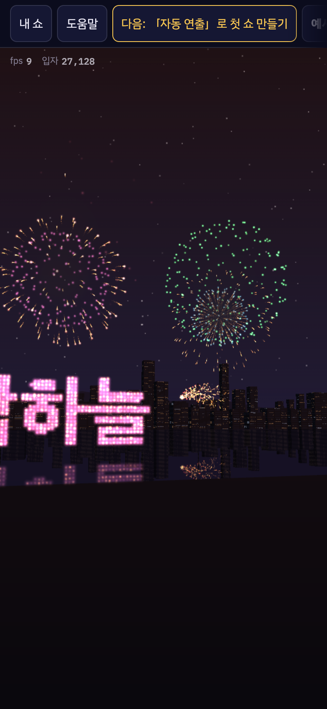
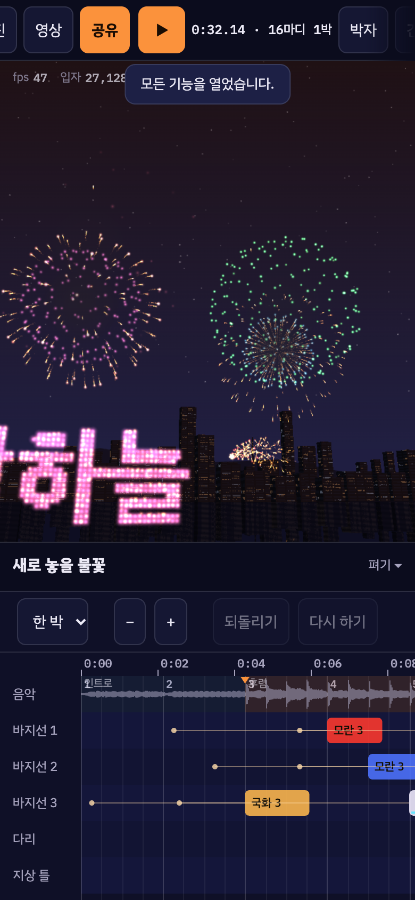
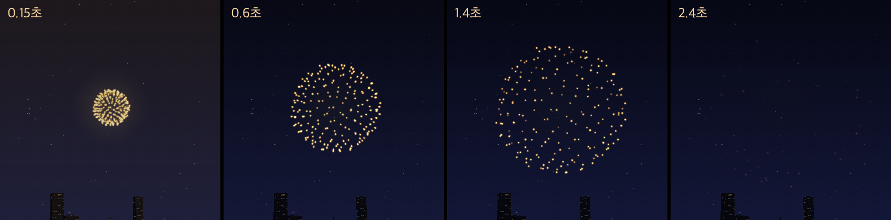

# 밤하늘 연출실 (night-sky-studio)

음악을 고르고 시간표 위에 불꽃을 놓아 나만의 불꽃축제를 연출하는 웹 시뮬레이터입니다.
설치 없이 브라우저에서 바로 열 수 있고, 만든 쇼는 링크 하나로 보낼 수 있습니다.

**▶ 바로 해 보기: https://juhee77.github.io/night-sky-studio/**

| 문서 | |
|:--|:--|
| [화면 설계](https://juhee77.github.io/night-sky-studio/docs/wireframes.html) | 화면별 와이어프레임과 실제 화면 ([docs/wireframes.html](docs/wireframes.html)) |
| [기획서](https://juhee77.github.io/night-sky-studio/docs/plan.html) | 기능, 단계, 용어 사전 ([docs/plan.html](docs/plan.html)) |
| [불꽃 점검표](docs/fireworks-audit.md) | 불꽃 종류와 공방 효과를 실제 원리와 대조한 결과 |
| [서버판](server/README.md) | 짧은 링크, 계정, 클라우드 저장, 상영관 |



## 할 수 있는 것

- **자동 연출**: 곡의 박자와 세기를 읽어 불꽃을 놓아 줍니다. 기본 곡이나 내 음악 파일을 씁니다.
- **직접 쏘기**: 음악을 들으며 키나 무대를 눌러 쏩니다. 터지는 순간이 박에 맞으면 「완벽!」이고, 쏜 기록은 시간표로 저장할 수 있습니다.
- **편집**: 시간표에서 불꽃 종류 · 크기 · 색 · 발사 위치(바지선 · 다리 · 지상 틀 · 드론)를 박자에 맞춰 놓습니다.
- **감상과 공유**: 무대만 화면 가득 보고, 링크 · 장노출 사진 · 영상(MP4)으로 보냅니다.
- **관객 반응**: 재생 중에 관객 실루엣과 「관객 열기」 게이지, 판정 글자가 나오고 함성과 환호, 메아리가 들립니다.
- **공작소**: 내 불꽃을 만듭니다.
  - 빠른 설계: 슬라이더로 바로
  - 제작 공방: 반구에 별을 붙여 알을 조립
  - 작업대: 배합부터 시험장까지 손으로
- **의뢰소**: 손님의 의뢰(곡 · 예산 · 조건)를 받아 납품하고, 돈과 평판으로 불꽃을 해금합니다.
  - 경력 이야기: 동네 축제에서 시작해 한강 세계불꽃축제 대회까지 올라갑니다.
  - 성적표: 등급, 항목별 점수, 가장 좋았던 순간과 아쉬웠던 순간, 최고 기록을 보여 줍니다.
- **발사장**: 평면도에서 바지선 자리와 안전거리를 정하고, 실전 모드에서는 허가 · 장전 · 배선까지 맞춥니다.
  - 무대는 기본 무대 7곳 중에서 고르거나, 지도에서 실제 장소를 골라 만듭니다. 처음 무대는 3D 건물과 다리가 있는 한강입니다.
- **단계별로 열기**: 처음에는 꼭 필요한 버튼만 보이고, 위 막대의 「다음: …」이 알려 주는 일을 해낼 때마다 기능이 하나씩 열립니다.

| 직접 쏘기 | 관객 반응 |
|:--:|:--:|
|  |  |

| 성적표 | 경력 이야기 |
|:--:|:--:|
|  |  |

| 편집 화면 | 공작소 제작 공방 |
|:--:|:--:|
|  |  |

| 휴대폰 간단 화면 | 휴대폰 편집 화면 |
|:--:|:--:|
|  |  |

## 물리와 실제 불꽃 이론

불꽃의 움직임은 대본이 아니라 계산으로 나옵니다.



*7호 모란. 처음에 가장 빠르게 퍼지고, 공기 저항으로 느려지다가 별이 다 타면 꺼집니다.*

- **크기**: 호수별 높이와 지름은 일본 불꽃 자료의 표를 따릅니다.
- **상승**: 알의 무게, 지름, 저항 계수로 계산합니다. 3호 약 4초, 5호 약 5초, 7호 약 6초, 10호 약 7초입니다.
- **별의 비행**: 모든 입자에 중력 9.8m/s²와 속도 제곱 공기 저항을 적용합니다. 불티가 천천히 떨어지는 것도 저항 때문입니다.
- **소리**: 음속만큼 늦게 들리고, 거리에 반비례해 작아집니다.
- **타는 모습**: 색온도, 깜빡임, 잔불, 연기를 그립니다.

종류별 판정과 근거, 아직 실측을 찾지 못해 어림한 값은 [불꽃 점검표](docs/fireworks-audit.md)에 적었습니다.

## 실행

```bash
npm install
npm run dev
```

| 명령 | 하는 일 |
|:--|:--|
| `npm run dev` | 개발 서버 (같은 Wi-Fi의 휴대폰에서도 열 수 있음) |
| `npm test` | 엔진 테스트 |
| `npm run typecheck` | 타입 검사 |
| `npm run e2e` | 화면 자동 테스트 (Playwright, 개발 서버를 띄워 실제 브라우저로 누름) |
| `npm run build:pages` | GitHub Pages용 정적판 빌드 → `apps/web/dist` |

## 로컬에서 서버판 해 보기

계정, 상영관, 짧은 링크, 이번 주 도전 순위까지 내 컴퓨터에서 써 볼 수 있습니다 (호스팅 없이).

```bash
npm run local
```

- 서버(+DB), 시험 데이터, 화면(서버 연결판)을 차례로 띄웁니다. 화면은 http://127.0.0.1:5174 입니다.
- Docker가 돌고 있으면 서버와 PostgreSQL을 컨테이너로, 아니면 서버 jar를 직접 띄우고 DB는 `server/data`의 H2 파일을 씁니다 (Java 25 필요). Docker가 있어도 H2로 하려면 `npm run local -- --h2`.
- 시험 데이터: 시험 계정 둘과 상영관 예시 쇼·내 불꽃, 이번 주 도전 글. 여러 번 돌려도 두 번 올리지 않습니다 (`npm run local:seed`로 따로, `npm run local -- --no-seed`로 빼기).
- 시험 계정 (로컬 전용): `별빛연출가` / `night-sky-local-1`, `불꽃장인` / `night-sky-local-2`
- Ctrl+C로 끕니다. Docker로 띄운 컨테이너는 `npm run local:stop`으로 끕니다.

## 배포

- **정적판 (GitHub Pages)**: `main`에 push하면 [pages.yml](.github/workflows/pages.yml)이 타입 검사와 테스트를 거쳐 앱과 `docs/`를 올립니다.
  - 앱: https://juhee77.github.io/night-sky-studio/
  - 공유 링크를 여는 상영관: `…/v/`
  - 문서: `…/docs/`
  - 쇼와 내 불꽃은 그 브라우저에만 저장됩니다.
- **서버판**: 짧은 링크, 계정, 클라우드 저장, 상영관이 필요하면 [server/README.md](server/README.md)를 보세요. 서버가 없어도 정적판은 그대로 동작합니다.
- PR마다 [ci.yml](.github/workflows/ci.yml)이 타입 검사, 엔진 테스트, 화면 자동 테스트, 정적판 빌드를 돌립니다.

## 구조

```
packages/engine   불꽃 계산, 자동 연출, 의뢰·채점, 불꽃 설계, 카메라, WebGL2 렌더러, 쇼 파일 규격 (화면 코드 없음)
apps/web          편집기(index.html)와 상영관(v/index.html)
apps/web/e2e      화면 자동 테스트
server            서버판 (Spring Boot)
docs              기획서, 화면 설계, 스크린샷
```

- 좌표는 무대 원점 기준 미터 `[동, 높이, 북]`입니다. 2D 화면도 3D 세계를 고정된 카메라로 본 것입니다.
- 계산은 1/120초 고정 간격으로만 합니다. 같은 쇼는 화면 주사율이나 기기와 상관없이 같게 재생됩니다.
- cue의 `t`는 터지는 시각입니다. 발사 시각은 카탈로그의 상승 시간을 빼서 엔진이 계산합니다.
- 화약 배합과 제조 공정은 게임용 근사이며 실제 제조 방법이 아닙니다.
